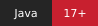
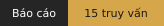

<p align="center">
  
</p>

<h1 align="center">Manchester United</h1>

<p align="center">
  <strong>Hệ thống quản lý câu lạc bộ bóng đá</strong><br>
  Hồ sơ cầu thủ, vận hành đội bóng và báo cáo dữ liệu trong một ứng dụng.
</p>

<p align="center">
  
  
  
  
</p>

<p align="center">
  <a href="#tong-quan">Tổng quan</a> &middot;
  <a href="#cai-dat">Cài đặt</a> &middot;
  <a href="#truy-van-sql">Truy vấn SQL</a> &middot;
  <a href="#cap-nhat-db">Cập nhật DB</a> &middot;
  <a href="#tai-lieu">Tài liệu</a>
</p>

---

<a id="tong-quan"></a>

## Tổng quan

| Nhóm chức năng | Nội dung |
| --- | --- |
| **Quản lý đội bóng** | Hồ sơ cầu thủ, hợp đồng, đăng ký mùa giải, ban huấn luyện, chấn thương và chuyển nhượng. |
| **Theo dõi thi đấu** | Lịch, kết quả, BXH EPL và chi tiết trận khi nguồn cung cấp dữ liệu. |
| **Khai thác dữ liệu** | 15 báo cáo SQL theo CLB, mùa giải và ngày báo cáo; chạy trên web hoặc trực tiếp trong MySQL. |

Backend dùng Java 17 và JDBC; giao diện HTML/CSS/JavaScript; CSDL MySQL gồm
11 bảng. Không cần Maven, npm hoặc Python để chạy web. JDBC driver và tài
nguyên ảnh đã có trong repo.

> [!NOTE]
> Dữ liệu mẫu thuộc mùa **2025–2026**. Web mặc định mùa **2026–2027**;
> lịch, kết quả và BXH mùa mới cần token football-data.org của riêng bạn.

<a id="cai-dat"></a>

## Cài đặt và chạy

### Chuẩn bị

- JDK 17 trở lên: cả `java` và `javac` phải có trong `PATH`.
- MySQL Server 8.4 trở lên đang chạy; biết tài khoản và mật khẩu MySQL.
- MySQL CLI hoặc MySQL Workbench để khởi tạo CSDL.
- Token football-data.org của riêng bạn để tải lịch, kết quả và BXH mùa mới.

```powershell
git clone https://github.com/hariet0905/MU-QuanLy.git
cd MU-QuanLy
java -version
javac -version
```

Các lệnh dưới đây chạy từ thư mục gốc `MU-QuanLy`, nơi có `submission.sql`.

### 01 · Khởi tạo CSDL

> [!IMPORTANT]
> Chỉ khởi tạo khi chưa có các bảng của dự án. Với DB đang sử dụng,
> xem [cập nhật DB](#cap-nhat-db). Không dùng `--force` để bỏ qua lỗi.

Nếu `mysql` có trong `PATH`:

```powershell
mysql --loose-commands --default-character-set=utf8mb4 -u root -p --execute="SOURCE submission.sql;"
```

Nhập mật khẩu MySQL tại lời nhắc.

<details>
<summary><strong>Dùng Workbench hoặc không tìm thấy lệnh mysql</strong></summary>

`--loose-commands` bật các lệnh CLI như `SOURCE` trên client có tùy chọn này;
client cũ chưa hỗ trợ sẽ bỏ qua tùy chọn.
Nếu PowerShell không tìm thấy `mysql`, dùng
đường dẫn tới `mysql.exe` trong thư mục cài MySQL, hoặc dùng Workbench:
mở cùng một kết nối, lần lượt chạy toàn bộ `db/01_schema.sql`,
`db/02_triggers.sql`, `db/03_procedures.sql`, `db/04_seed.sql`,
`db/05_reports.sql`. Chỉ tiếp tục khi file trước thành công.
`submission.sql` dùng lệnh `SOURCE` của CLI, không chạy trực tiếp trong Workbench.

</details>

Tên DB mặc định là `csdl1_mu_2025_26`; DB này có thể chứa nhiều mùa giải.
Dữ liệu mẫu thuộc mùa **2025–2026**, phục vụ minh họa nghiệp vụ và truy vấn.

### 02 · Kết nối nguồn bóng đá

```powershell
Copy-Item .env.example .env
```

Mở `.env` tại thư mục gốc, điền token của bạn sau `FOOTBALL_DATA_API_KEY=`.
File này bị Git bỏ qua. Có thể dùng biến môi trường cùng tên; biến môi
trường được ưu tiên. Khởi động lại Java sau khi đổi token.

Web mặc định mùa **2026–2027**; tự đồng bộ khi khởi động và khoảng 2 phút/lần.
Thiếu token hoặc nguồn chưa cung cấp mùa đã chọn thì web vẫn khởi động,
nhưng phần phụ thuộc nguồn sẽ báo thiếu cấu hình/chờ dữ liệu. Dữ liệu mẫu
2025–2026 không thay thế lịch hoặc kết quả mùa mới. Đội hình tham chiếu,
nếu có, được ghi rõ mùa nguồn.

BXH và chi tiết bổ sung từ ESPN là dữ liệu cache, không phải bảng trong DB.
ESPN không cần token. Thống kê không có trong nguồn được để trống; mức độ
đầy đủ và độ trễ phụ thuộc nguồn. Không có chức năng nhập tay trận/lần ra sân.

### 03 · Khởi động ứng dụng

Windows PowerShell:

```powershell
.\app\setup-admin.bat
.\app\run.bat
```

Tạo tên đăng nhập 3–40 ký tự (chữ, số, `.`, `_`, `-`) và mật khẩu từ 12 ký tự.
Đây là tài khoản web riêng, không phải tài khoản MySQL. Không có tài khoản
mặc định; lần chạy đầu cũng tự hỏi nếu chưa tạo. Mật khẩu nhập trong terminal
không hiển thị ký tự. Sau đó nhập mật khẩu MySQL khi `run.bat` hỏi.

**Mở ứng dụng: <http://127.0.0.1:8080>**

Đăng nhập bằng tài khoản vừa tạo. Giữ terminal
đang chạy; `Ctrl+C` để dừng. Nếu đang đứng trong thư mục `app`, dùng
`.\run.bat`, không thêm `app` lần nữa.

macOS/Linux: chạy `sh app/run.sh`; tạo quản trị viên qua lời nhắc lần đầu.

Thông tin quản trị được lưu dưới dạng salt và băm mật khẩu trong
`app/.admin.properties`, không đưa lên Git. Ứng dụng chỉ lắng nghe
`127.0.0.1`, phục vụ chạy trên máy cá nhân.

<details>
<summary><strong>Tùy chỉnh kết nối MySQL và cổng web</strong></summary>

| Biến môi trường | Mặc định |
| --- | --- |
| `DB_URL` | `jdbc:mysql://localhost:3306/csdl1_mu_2025_26?useUnicode=true&characterEncoding=UTF-8&serverTimezone=Asia/Ho_Chi_Minh` |
| `DB_USER` | `root` |
| `DB_PASSWORD` | Hỏi trong terminal khi chưa đặt |
| `PORT` | `8080` |

Đặt các biến trên trong terminal trước khi chạy, ví dụ `$env:PORT='8081'`
trong PowerShell hoặc `export PORT=8081` trên macOS/Linux. Dùng cổng đã chọn
trong URL truy cập. **Các biến DB và PORT không được đọc từ `.env`**;
ứng dụng chỉ đọc token bóng đá từ file đó.

</details>

---

<a id="truy-van-sql"></a>

## Truy vấn trực tiếp trong MySQL

> [!TIP]
> Mở `db/05_reports.sql` trong Workbench để xem đủ 15 báo cáo.
> Không cần chạy web hoặc có token API.

**`db/05_reports.sql` là bộ truy vấn của ứng dụng, cần giữ khi clone.**
File chứa 15 câu `SELECT`, không phải file tạm sinh ra để kiểm thử.
Câu SQL nằm trong repo; dữ liệu nguồn nằm trong 11 bảng MySQL. Chạy truy vấn
sẽ tính kết quả từ dữ liệu hiện có, không tạo sẵn 15 bảng hay view báo cáo.

Sau khi khởi tạo DB, mở và chạy `db/05_reports.sql` trong Workbench, hoặc:

```powershell
mysql --loose-commands --default-character-set=utf8mb4 -u root -p --execute="SOURCE db/05_reports.sql;"
```

Không cần chạy Java hay có token API để thực hiện các truy vấn này. Đầu file
chọn mùa `2025-26`, CLB quản lý và ngày `2026-05-24` để minh họa với seed.
Muốn đổi tham số: đặt `@season_id`, `@club_id`, `@as_of`, rồi chỉ chạy câu
Q cần xem trong cùng kết nối; chạy lại toàn file sẽ đặt lại tham số minh họa.
Web tự đặt tham số theo mùa/ngày đang chọn.

Nội dung từng Q01–Q15 và quy tắc dữ liệu: **[Báo cáo CSDL](report-db.md)**.

<a id="cap-nhat-db"></a>

## Đã có DB từ bản cũ

Không chạy lại `submission.sql`. Dừng Java, kiểm tra rồi cập nhật guard:

```powershell
.\app\update-db.bat --check
.\app\update-db.bat --apply
```

`--check` chỉ kiểm tra, chưa áp dụng cập nhật. Công cụ chọn migration guard
002/003 phù hợp, sao lưu định nghĩa trigger/thủ tục và giữ nguyên dữ liệu.
Chỉ mở lại web khi cập nhật thành công. Nếu DB rất cũ chưa có cột `kien_tao`
trong `CauThu_TranDau`, áp dụng riêng `db/migrations/001_add_assists.sql`
một lần trước; DB tạo mới đã có cột này.

---

<a id="tai-lieu"></a>

## Cấu trúc và tài liệu

| Đường dẫn | Nội dung |
| --- | --- |
| `app/` | Mã Java, script chạy, JDBC driver |
| `app/web/` | Giao diện, ảnh, logo, cờ và ghi nguồn ảnh |
| `db/` | Schema, trigger, procedure, seed, Q01–Q15 và migration |
| `resources/readme/` | Badge SVG dùng trong trang giới thiệu |
| `resources/design/` | ER hiện hành và ảnh đối chiếu |
| `resources/references/` | Yêu cầu bài tập, tài liệu Word |

ER hiện hành: [sơ đồ đã xác nhận](resources/design/899730302_906908339083363_4183998577844837985_n.png).
`resources/design/image.png` là bản cũ để đối chiếu.
Nguồn ảnh: [photo-credits.html](app/web/photo-credits.html).
Giấy phép thư viện nằm trong `app/lib/`.

Repo không chứa mật khẩu, token, tài khoản quản trị hoặc bản sao DB đang
chạy trên máy người phát triển. Mỗi máy clone tự khởi tạo và cấu hình riêng.

<p align="center">
  <a href="#tong-quan">Về đầu trang</a>
</p>
