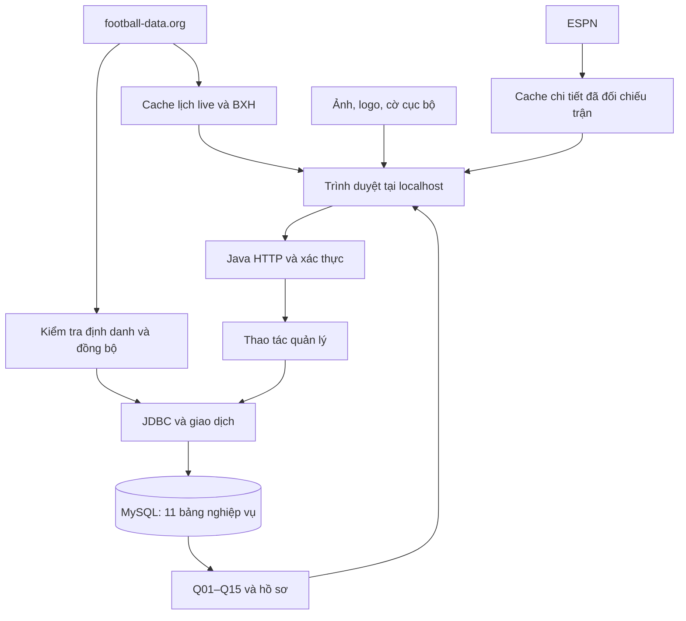

# Báo cáo tổng hợp dự án quản lý câu lạc bộ Manchester United

**Dự án:** CSDL1-Football-Management — Nhóm 26  
**Ngày lập:** 12/11/2026  
**Phạm vi:** yêu cầu, thiết kế ER, CSDL, ứng dụng, nguồn API, giới hạn và bảo toàn dữ liệu.

## 1. Trạng thái tại thời điểm báo cáo

Dự án xây dựng ứng dụng quản lý Manchester United tại Premier League: hồ sơ cầu thủ, hợp đồng, đăng ký theo mùa, y tế, chuyển nhượng, lịch đấu, kết quả, thống kê và báo cáo. Các CLB khác là đối thủ hoặc đối tác; hệ thống không được diễn giải thành ứng dụng quản trị đồng thời toàn bộ CLB EPL.

Thiết kế hiện hành có **11 bảng nghiệp vụ**. Giao diện dùng JavaScript; backend Java 17 qua JDBC; CSDL MySQL. Đăng nhập một quản trị viên, ảnh, logo, cờ và cache API nằm ngoài các bảng nghiệp vụ để giữ ER đã thống nhất.

| Hạng mục | Trạng thái xác nhận |
| --- | --- |
| ER được chấp thuận | Ảnh `resources/design/899730302_906908339083363_4183998577844837985_n.png`; vị trí 1–N cầu thủ |
| Schema trong workspace | Có cột kiến tạo nullable; giữ 11 bảng và các khóa hiện hành |
| Sửa lỗi thao tác ghi | Đã đồng bộ backend, frontend, trigger và procedure; giữ nguyên ER |
| Bản cập nhật DB cũ | Có migration 001, 002 và công cụ cập nhật 002 |
| Migration 002 trên DB thật | **Chưa xác nhận áp dụng; chưa được coi DB thật đã nhận bản sửa** |
| Migration 001 trên DB thật | Cần kiểm tra cột thực tế; không suy ra đã áp dụng từ việc có file SQL |
| Dữ liệu thật của người dùng | Không reset, không nạp lại seed, không tự sửa/xóa trong đợt sửa và lập báo cáo |
| Lần lập báo cáo này | Đọc tài liệu/mã nguồn, đối chiếu kết quả đã chạy; không chạy migration lên DB thật |

Các kết luận “đã sửa” trong báo cáo nói về **mã nguồn và DB thử**. Hiệu lực trên DB thật phụ thuộc phiên bản trigger/procedure thực tế và việc chạy cập nhật thành công.

## 2. Nguồn yêu cầu và thứ tự đối chiếu

| Nguồn | Vai trò |
| --- | --- |
| [Báo cáo CSDL](../../report-db.md) | Cấu trúc, quy tắc dữ liệu và Q01–Q15 |
| [ER mới](../design/899730302_906908339083363_4183998577844837985_n.png) | Mô hình đã được người dùng xác nhận |
| [Yêu cầu nghiệp vụ và Q01–Q15](../references/Anh_man_hinh_2026-11-11_luc_21.32.01.png) | Phạm vi bài toán CLB và báo cáo |
| [db/01_schema.sql](../../db/01_schema.sql) | Bảng, kiểu dữ liệu, NULL, PK, FK, UNIQUE, CHECK và chỉ mục |
| [db/02_triggers.sql](../../db/02_triggers.sql), [db/03_procedures.sql](../../db/03_procedures.sql) | Kiểm tra liên bảng, bảo vệ lịch sử và giao dịch chuyển nhượng |
| [db/04_seed.sql](../../db/04_seed.sql), [db/05_reports.sql](../../db/05_reports.sql) | Dữ liệu khởi tạo và truy vấn báo cáo |
| [Báo cáo Word ban đầu](../references/Bao_cao_Quan_ly_CLB_Manchester_United_Nhom_26.docx) | Giải thích mô hình và dữ liệu mẫu; có mô tả triển khai trước đợt sửa mới |
| [Bài tập lớn.docx](<../references/Bài tập lớn.docx>) | Yêu cầu chung về thiết kế, dữ liệu, truy vấn, ứng dụng và sản phẩm nộp |
| [Báo cáo CSDL](../../report-db.md) | Hướng dẫn schema, migration và báo cáo |

Điều chỉnh được người dùng xác nhận được ưu tiên khi tài liệu cũ mâu thuẫn. Không dùng ER cũ hoặc đoạn SQL cũ để bỏ qua ER mới. Nếu còn mâu thuẫn chưa được giải quyết, phải nêu cụ thể trước khi làm phần phụ thuộc.

Các điểm cần phân biệt:

- `resources/design/image.png` là ER cũ. Nhãn N/1 của quan hệ vị trí–cầu thủ trong bản cũ không phải yêu cầu đổi lực lượng quan hệ.
- `resources/design/902020578_1785595712554239_3106113575905389221_n.png` là ảnh mô hình tham khảo, chưa được coi tự động tương đương schema hiện hành.
- Word ban đầu mô tả thủ tục chuyển nhượng yêu cầu phí và mốc hợp đồng xác định. Bản hiện tại đã hỗ trợ phí NULL và xử lý biên hợp đồng NULL theo quy ước đang dùng; không được dùng mô tả cũ để kết luận mã hiện tại vẫn bắt buộc phí.
- Một số chú thích SQL còn nhắc `NGUON_DU_LIEU.md`, nhưng chưa thấy file này trong workspace. Liên kết đó chưa phải nguồn có thể kiểm chứng tại đây.

## 3. Yêu cầu tổng thể và các quyết định đã thống nhất

### 3.1. Phạm vi nghiệp vụ gốc

Hệ thống phải lưu được thông tin CLB, cầu thủ, vị trí chính, hợp đồng qua thời gian, mùa giải, các giai đoạn đăng ký, nhiệm kỳ BHL, trận đấu, lần ra sân, chấn thương và giao dịch chuyển nhượng. Lịch sử phải giữ được khi cầu thủ đổi CLB trong cùng mùa hoặc qua nhiều mùa.

Các yêu cầu truy vấn gồm Q01–Q15. Kết quả phải dùng đúng CLB quản lý, mùa và ngày báo cáo tương ứng. Thành tích chỉ tính trận hoàn tất; lịch đấu và lịch sử hợp đồng có phạm vi khác các thống kê đến ngày báo cáo.

Yêu cầu chung của bài tập có thiết kế CSDL, dữ liệu mẫu, script SQL, truy vấn và chương trình thao tác CSDL. Tài liệu chung có hướng Java/MySQL; phần nâng cao nhắc Redis. Hiện dự án có Java/MySQL và cache bộ nhớ Java, **chưa có triển khai Redis**. Cache bộ nhớ không được ghi nhận là đã hoàn thành phần Redis.

### 3.2. Yêu cầu bổ sung trong quá trình phát triển

| Yêu cầu | Cách thực hiện/phạm vi |
| --- | --- |
| Tách DB thành các file theo mục đích | Schema, trigger, procedure, seed, reports; `submission.sql` điều phối |
| Bỏ nhập trận và chỉ số cầu thủ bằng tay | Backend từ chối các action thủ công; lấy dữ liệu qua nguồn API đã chọn |
| Chỉ chọn mùa từ 2026–2027 trở đi | Năm đầu 2026, tối đa năm hiện tại + 1; không chuyển dữ liệu mùa cũ sang mùa mới |
| Đồng bộ tự động | Bắt đầu khi backend chạy và lặp khoảng 120 giây; không có bảng/nút đồng bộ nguồn riêng |
| Xem live timing | Hiển thị trạng thái, phút và tỷ số nguồn cung cấp; không tự tính phút từ đồng hồ |
| Giữ danh sách cầu thủ khi mùa mới chưa có đăng ký | Đọc tham chiếu đăng ký cuối mùa 2025–26, có nhãn nguồn; không ghi đăng ký giả |
| Hồ sơ cầu thủ chi tiết | Ảnh, quốc tịch/cờ, số áo theo đăng ký, thống kê, trận gần đây và radar |
| Trang tổng quan | Trận gần nhất, countdown trận tiếp theo và phân bố vị trí có nhãn |
| Giao diện gọn, ít slogan, tên CLB cùng dòng | Chỉnh cách trình bày và tài nguyên; không thay mô hình DB |
| Animation phù hợp từng thao tác | Chuyển trang, lọc, modal, radar, phản hồi và đổi thứ hạng có cách xử lý riêng |
| Một tài khoản đăng nhập | Lưu xác thực ngoài DB, ưu tiên giữ nguyên ER |
| BXH EPL, phong độ và chi tiết CLB/trận | Chỉ đọc nguồn/cache; không tạo bảng thống kê nâng cao ngoài ER |
| Nếu tính năng ảnh hưởng rule | Nêu điểm ảnh hưởng trước; không tự thay thiết kế để chạy được tính năng |

## 4. Kiến trúc và luồng dữ liệu

### 4.1. Công nghệ

| Thành phần | Triển khai |
| --- | --- |
| Frontend | HTML, CSS, JavaScript thuần, SVG và Web Animations API |
| Backend | Java 17, `com.sun.net.httpserver.HttpServer`, JDBC |
| CSDL | MySQL; SQL ghi mục tiêu 8.4+, môi trường phát triển dùng 9.7.2 |
| Driver có trong workspace | MySQL Connector/J 8.4.0 |
| Nguồn lịch/kết quả/BXH | football-data.org |
| Nguồn bổ sung chi tiết | ESPN; cache chỉ đọc |
| Xác thực | PBKDF2-HMAC-SHA256, phiên bộ nhớ |
| Chạy ứng dụng | Script biên dịch Java trực tiếp; không cần Spring để đáp ứng phần triển khai này |



Sơ đồ thể hiện đường ghi nghiệp vụ qua JDBC và đường chỉ hiển thị qua cache. Việc thấy số liệu trên màn hình không chứng minh số liệu đó đã có trong các bảng MySQL.

### 4.2. Các module chính

| File/thư mục | Trách nhiệm |
| --- | --- |
| [app/FootballWeb.java](../../app/FootballWeb.java) | HTTP, xác thực trước API, đọc workspace, báo cáo và các action quản lý |
| [app/FootballData.java](../../app/FootballData.java) | Đồng bộ football-data.org, ánh xạ ID, cache, nhập trận/lần ra sân theo giao dịch |
| [app/FootballViews.java](../../app/FootballViews.java) | Chuẩn hóa chi tiết và tính phong độ từ kết quả đúng mùa |
| [app/EspnFootball.java](../../app/EspnFootball.java) | Đối chiếu trận ESPN, chuẩn hóa thống kê đội/cầu thủ để hiển thị |
| [app/AdminAuth.java](../../app/AdminAuth.java) | Tạo quản trị viên, kiểm tra mật khẩu, phiên, giới hạn đăng nhập sai |
| [app/DbWriteRules.java](../../app/DbWriteRules.java) | Kiểm tra các dấu hiệu trigger/procedure mới trước action quản lý |
| [app/UpdateDatabase.java](../../app/UpdateDatabase.java) | Kiểm tra dữ liệu trước cập nhật, sao lưu và thay định nghĩa trigger/procedure |
| [app/Json.java](../../app/Json.java) | Phân tích JSON nguồn |
| [app/web/app.js](../../app/web/app.js) | Điều hướng, tải dữ liệu, bảng, form, modal và xử lý phản hồi |
| `dashboard.js`, `player-detail.js`, `details.js`, `standings.js` | Tổng quan, hồ sơ, chi tiết trận/CLB và BXH |
| [app/web/motion.js](../../app/web/motion.js) | Animation theo thao tác, hỗ trợ giảm chuyển động |
| `app/web/photos`, `crests`, `flags` | Tài nguyên giao diện, không phải bảng/cột DB mới |
| `app/tools` | Tải/đối chiếu tài nguyên ảnh, không phải luồng tạo đăng ký/hợp đồng |

### 4.3. Các API nội bộ

| Đường dẫn | Mục đích |
| --- | --- |
| `GET /api/session` | Xem trạng thái phiên |
| `POST /api/login`, `POST /api/logout` | Đăng nhập/đăng xuất |
| `GET /api/data` | Workspace DB, ngữ cảnh mùa/ngày và cache lịch |
| `POST /api/action` | Action quản lý đã cho phép hoặc yêu cầu đổi mùa |
| `GET /api/standings` | BXH theo năm mùa |
| `GET /api/match-detail` | Chi tiết trận theo provider ID và đúng mùa |

Ngoài các đường xác thực cần thiết, API nghiệp vụ yêu cầu phiên quản trị hợp lệ. Thao tác ghi kiểm tra header `X-CSDL1`, Origin và Host. Dữ liệu được đưa vào truy vấn tham số hóa.

## 5. Thiết kế DB hiện hành

### 5.1. Mười một bảng nghiệp vụ

| Bảng | Định danh và trường chính | Liên kết/ý nghĩa |
| --- | --- | --- |
| `ViTri` | PK `id`; `ma_vi_tri` UNIQUE; `ten_hien_thi` | Danh mục GK, DF, MF, FW |
| `CauThu` | PK `id`; tên, ngày sinh, quốc tịch, vị trí chính | FK `vi_tri_chinh_id` tới `ViTri` |
| `CauLacBo` | PK `id`; tên UNIQUE, thành phố, sân, liên hệ, dấu quản lý | Cột sinh và UNIQUE bảo đảm tối đa một CLB quản lý |
| `HopDong` | PK `id`; cầu thủ, CLB, ngày đầu/cuối, ghi chú | Hai FK tới cầu thủ và CLB; lưu lịch sử hợp đồng |
| `MuaGiai` | PK `id`; mã mùa UNIQUE; ngày đầu/cuối | Khung mùa cho đăng ký và trận |
| `CauThu_MuaGiai` | PK `id`; cầu thủ, mùa, CLB, khoảng đăng ký, số áo | Ba FK; mỗi bản ghi là một giai đoạn đăng ký |
| `ThanhVienBHL` | PK `id`; CLB, họ tên, vai trò, liên hệ, ngày đầu/cuối | Mỗi bản ghi là một nhiệm kỳ; không có bảng nhân sự độc lập bổ sung |
| `TranDau` | PK `id`; mùa, chủ nhà, khách, thời gian, sân, trạng thái, tỷ số | Ba FK tới mùa và hai vai trò CLB |
| `CauThu_TranDau` | PK ghép `(tran_dau_id, cau_thu_id)`; CLB đại diện, phút, bàn, kiến tạo, thẻ | Ba FK tới trận, cầu thủ, CLB; một cầu thủ tối đa một bản ghi trong một trận |
| `ChanThuong` | PK `id`; cầu thủ, mô tả, thời điểm, ngày nghỉ/dự kiến/thực tế, cờ cấm | FK tới cầu thủ; một bản ghi cho một đợt |
| `ChuyenNhuong` | PK `id`; cầu thủ, CLB đi/đến, ngày hiệu lực, phí | Ba vai trò FK; UNIQUE cầu thủ/ngày hiệu lực |

Các cột kỹ thuật như `created_at`, `updated_at` không thay vai trò của lịch sử nghiệp vụ. Không dùng chúng để suy ra ngày ký hợp đồng hay ngày chuyển CLB.

### 5.2. Lực lượng liên kết phải giữ

- `ViTri (1) — (N) CauThu`: một cầu thủ có một vị trí chính; nhiều cầu thủ có thể cùng vị trí.
- `CauThu` và `CauLacBo` có nhiều bản ghi `HopDong` qua thời gian.
- Mỗi `CauThu_MuaGiai` thuộc đúng một cầu thủ, một CLB và một mùa. Một cầu thủ có thể có nhiều giai đoạn trong cùng mùa nếu không chồng lấn.
- Mỗi trận thuộc một mùa, có một CLB chủ nhà và một CLB khách khác nhau. Mỗi CLB/mùa có thể có nhiều trận.
- Mỗi lần ra sân thuộc một trận, một cầu thủ và một CLB đại diện. Không suy ra CLB đại diện từ CLB hiện tại của cầu thủ.
- Một cầu thủ có thể có nhiều đợt chấn thương và nhiều giao dịch chuyển nhượng.
- CLB đi được để NULL cho cầu thủ tự do; CLB đến của giao dịch là bắt buộc.
- Một CLB có nhiều nhiệm kỳ BHL; mỗi nhiệm kỳ thuộc một CLB.

Không chuyển số áo hoặc CLB hiện tại thành thuộc tính thay thế lịch sử trong `CauThu`. Không gộp danh sách sự kiện, CLB hoặc các liên kết nhiều–nhiều vào một cột.

### 5.3. Dữ liệu khởi tạo và dữ liệu thật

Đếm các bản ghi khai báo trong [04_seed.sql](../../db/04_seed.sql):

| Bảng | Số bản ghi seed |
| --- | ---: |
| `ViTri` | 4 |
| `CauLacBo` | 23 |
| `MuaGiai` | 1 |
| `CauThu` | 34 |
| `HopDong` | 34 |
| `CauThu_MuaGiai` | 34 |
| `ThanhVienBHL` | 3 |
| `TranDau` | 38 |
| `CauThu_TranDau` | 566 |
| `ChanThuong` | 0 |
| `ChuyenNhuong` | 5 |

Đây là số liệu **của file seed**, không phải số lượng hiện tại trong DB người dùng. Seed thuộc mùa 2025–26; chú thích dữ liệu ghi mốc đối chiếu 10/11/2026. Chưa xác minh đầy đủ mốc hợp đồng/phí thì để NULL; bảng chấn thương trống có chủ đích vì chưa có dữ liệu y tế được xác minh.

Tài nguyên giao diện có 34 chân dung, 26 logo và 17 cờ theo bộ hiện có. Số logo không phải số CLB đang có trong seed hay số đội của một mùa EPL.

## 6. Quy tắc bắt buộc đối với dữ liệu

### 6.1. Nguyên tắc mô hình và lịch sử

| Mã | Quy tắc |
| --- | --- |
| R01 | Tuân thủ ER mới và cấu trúc DB; không tự thêm/xóa/đổi bảng, cột, kiểu, NULL, khóa hoặc lực lượng liên kết |
| R02 | Giữ FK, CHECK, UNIQUE và hạn chế sửa/xóa; không tắt ràng buộc để vượt lỗi |
| R03 | Không làm mất lịch sử hợp lệ khi sửa hồ sơ, hợp đồng, đăng ký, mùa, trận hoặc y tế |
| R04 | Thiếu dữ liệu thì giữ NULL khi schema cho phép; không bịa giá trị để đủ form |
| R05 | Mỗi nguồn có hệ ID riêng; không dùng ID nguồn làm ID DB khi chưa ánh xạ đúng |
| R06 | Chỉ đổi mô hình khi có yêu cầu rõ; nếu chưa được phép, dừng phần phụ thuộc và nêu điểm ảnh hưởng |

UNIQUE trên CLB quản lý chỉ bảo đảm **tối đa một**, không tự bảo đảm luôn có một. Ứng dụng còn yêu cầu tìm được CLB quản lý hợp lệ để hoạt động. Không mặc định ID CLB/mùa bằng 1 trong luồng nghiệp vụ.

### 6.2. Quy tắc thời gian

Hợp đồng và đăng ký dùng khoảng **`[ngày bắt đầu, ngày kết thúc)`**. Ngày kết thúc không còn hiệu lực. Ví dụ, hợp đồng kết thúc 01/10/2026 và hợp đồng mới bắt đầu 01/10/2026 không chồng nhau.

Ngày cuối mùa và ngày cuối nhiệm kỳ BHL được tính bao gồm. Vì vậy, đăng ký đến hết ngày cuối mùa có biên kết thúc là ngày cuối mùa + 1.

- Nếu biết cả hai mốc hợp đồng, ngày kết thúc phải sau ngày bắt đầu.
- Không có hai hợp đồng cùng cầu thủ giao nhau, kể cả khác CLB.
- Đăng ký phải nằm trong mùa và có hợp đồng cùng cầu thủ/CLB bao phủ toàn khoảng.
- Không chồng đăng ký cùng cầu thủ/cùng mùa.
- Không trùng số áo cùng CLB, mùa và các khoảng thời gian giao nhau.
- Ngày sinh không ở tương lai hoặc sau các sự kiện nghiệp vụ đã ghi nhận.
- Không thêm hợp đồng, đăng ký, chấn thương, lần ra sân hoặc chuyển nhượng trước ngày sinh đã biết.
- Đổi ngày sinh phải kiểm tra lịch sử, không chỉ kiểm tra ngày hiện tại.

Trong kiểm tra khoảng, mốc hợp đồng NULL được xử lý bằng biên rộng theo logic hiện có. Đây là quy ước kỹ thuật để kiểm tra, **không phải chứng minh hợp đồng thực tế vô thời hạn hoặc cầu thủ đủ điều kiện pháp lý**.

### 6.3. Quy tắc trận và lần ra sân

- Hai CLB của trận phải khác nhau; ngày thi đấu thuộc mùa.
- Trạng thái DB gồm `SCHEDULED`, `COMPLETED`, `POSTPONED`, `CANCELLED`.
- Chỉ `COMPLETED` có đủ hai giá trị tỷ số; trạng thái khác giữ tỷ số NULL.
- Chỉ ghi lần ra sân cho trận `COMPLETED`.
- CLB đại diện phải tham gia trận; cầu thủ phải có đăng ký và hợp đồng phù hợp tại ngày đó.
- Không được ra sân trong khoảng chấn thương có cờ cấm thi đấu.
- Số phút 0–90, thẻ vàng 0–2, thẻ đỏ 0–1; các miền số khác theo kiểu và CHECK hiện có.
- Không cộng bù giờ vào miền phút DB. Vào sân phút 90/bù giờ có thể có 0 phút quy đổi nhưng vẫn là một lần ra sân.
- Không ép tổng bàn cá nhân bằng bàn CLB vì có thể có bàn phản lưới.
- Không xóa lần ra sân lịch sử; việc hiệu chỉnh số liệu vẫn phải giữ các điều kiện hợp lệ.
- Không hạ trạng thái trận đã có thống kê sang trạng thái làm mất tính hợp lệ của lịch sử.

### 6.4. Quy tắc y tế

- Ngày bắt đầu nghỉ không trước ngày xảy ra chấn thương.
- Ngày dự kiến/thực tế trở lại, nếu có, không trước ngày bắt đầu nghỉ.
- Ngày trở lại **thực tế** không được ở tương lai. Ngày dự đoán phải dùng trường dự kiến.
- Cấm lưu lặp cùng cầu thủ, mô tả, thời điểm xảy ra và ngày bắt đầu nghỉ.
- Không cấm toàn bộ chấn thương cùng ngày hoặc giao nhau: các đợt khác nhau vẫn có thể tồn tại.
- Thêm/sửa chấn thương cấm thi đấu không được phủ lên lần ra sân đã lưu.
- Không xóa lịch sử chấn thương; bản trùng cũ không tự gộp/xóa trong migration.

Khoảng nghỉ cấm thi đấu dùng ngày thực tế trở lại làm biên kết thúc; nếu chưa có thì chưa ghi nhận kết thúc. Ngày dự kiến không tự kết thúc đợt nghỉ. Không có bản ghi chấn thương không đồng nghĩa được xác nhận khỏe mạnh.

### 6.5. Quy tắc chuyển nhượng

- Giao dịch phải liên quan CLB quản lý khi thực hiện qua ứng dụng.
- CLB đi và đến khác nhau; CLB đi có thể NULL cho cầu thủ tự do.
- Phí có giá trị thì không âm; backend giới hạn tối đa 13 chữ số nguyên và 2 chữ số thập phân, theo `DECIMAL(15,2)`.
- Phí NULL là chưa biết; phí 0 là miễn phí đã xác định; đơn vị báo cáo GBP.
- Một cầu thủ tối đa một giao dịch trong cùng ngày theo UNIQUE hiện hành.
- Ngày hiệu lực thuộc mùa chọn; ngày kết thúc hợp đồng mới sau ngày hiệu lực.
- Với CLB nguồn có chỉ định, phải tìm được hợp đồng/đăng ký nguồn phù hợp.
- Thủ tục hiện yêu cầu ngày chuyển nằm giữa các biên nguồn theo điều kiện SQL; không hỗ trợ mọi trường hợp kết thúc đăng ký ngay ngày đầu.
- Nếu cắt hợp đồng làm mất căn cứ đăng ký mùa khác, từ chối toàn giao dịch; không tự xóa hoặc rút ngắn đăng ký đó.
- Giao dịch hoàn tất không được sửa/xóa tùy ý.

Không tự thêm quy tắc tuổi tối thiểu, giới hạn danh sách 25 người, homegrown, treo giò hoặc các quy chế EPL chưa có trong mô hình/yêu cầu. DB hiện không phải bộ máy xác nhận đầy đủ tư cách thi đấu EPL.

## 7. Toàn bộ thao tác chỉnh sửa có trên ứng dụng

| Action | Bảng bị tác động | Kiểm tra và bảo toàn hiện tại |
| --- | --- | --- |
| `onboard` — tiếp nhận | Thêm `CauThu`, `HopDong`, `CauThu_MuaGiai` | Một giao dịch; ngày hợp lệ, vị trí, khoảng đăng ký/hợp đồng, áo; lỗi rollback cả ba |
| `edit` — sửa hồ sơ | Sửa `CauThu` | Tên, quốc tịch, ngày sinh, vị trí; ngày sinh không được phá lịch sử |
| `contract` — thêm hợp đồng | Thêm `HopDong` | Không chồng lấn; mốc trước ngày sinh bị chặn; mốc nullable được để trống |
| `register` — đăng ký | Thêm `CauThu_MuaGiai` | Khóa và kiểm tra hợp đồng cùng giao dịch; giới hạn cuối theo mùa; chống chồng khoảng/trùng áo |
| `injury` — chấn thương | Thêm `ChanThuong` | Ngày, mô tả, dự kiến nullable, cờ cấm thi đấu, chống trùng, đối chiếu lịch sử DB |
| `recover` — hồi phục | Sửa ngày thực tế của `ChanThuong` | Không trước nghỉ, không tương lai, không kéo dài khoảng cấm qua lần ra sân |
| `transfer` — chuyển nhượng | Sửa nguồn, thêm hợp đồng/đăng ký đích và `ChuyenNhuong` | Procedure tự quản lý giao dịch; kiểm tra các mùa phụ thuộc; lỗi khôi phục toàn bộ |
| `delete` — xóa nhập nhầm | Xóa `CauThu` | Chỉ thành công khi không còn liên kết bị FK RESTRICT bảo vệ; không cascade lịch sử |
| `season` — đổi mùa | Yêu cầu đồng bộ nền | Không đổi mùa của bản ghi cũ; có thể dẫn đến các ghi tự động đúng mùa |

`owned` hiện nghĩa là cầu thủ **từng có hợp đồng MU**, không phải xác nhận còn hợp đồng tại ngày nhập. Không được dùng trường này để tuyên bố CLB sở hữu hiện tại.

Các thao tác chưa có form: quản lý vị trí/CLB, nhiệm kỳ BHL, sửa khung mùa, sửa/xóa hợp đồng, sửa/kết thúc/xóa đăng ký, thay đổi số áo bằng cách chia giai đoạn, sửa đầy đủ các trường đợt chấn thương. Không coi việc schema có bảng/cột là giao diện đã hỗ trợ mọi CRUD.

Các action thủ công `match`, `schedule`, `appearance`, `sync` bị backend từ chối. Trận và chỉ số không được mở lại form nhập tay để khắc phục thiếu API.

## 8. Giao dịch và cơ chế bảo toàn

### 8.1. Tiếp nhận và các action quản lý

Các action quản lý ngoài chuyển nhượng chạy trong giao dịch: khóa mùa, khóa cầu thủ liên quan, kiểm tra và ghi rồi commit. Trường hợp lỗi rollback. Với tiếp nhận, hồ sơ, hợp đồng và đăng ký phải cùng thành công; không để hồ sơ/hợp đồng lẻ khi số áo trùng hoặc đăng ký sai mùa.

Trước các action này, `DbWriteRules.requireInstalled` kiểm tra dấu hiệu trong định nghĩa các trigger và procedure mới. Thiếu hoặc cài dở thì chặn thao tác quản lý và báo cập nhật DB; không tự thay schema lúc người dùng bấm Lưu.

### 8.2. Chuyển nhượng

`sp_hoan_tat_chuyen_nhuong` tự mở giao dịch và có handler rollback/resignal. Backend không thêm commit riêng làm chia nhỏ giao dịch của thủ tục.

Trình tự hiện tại: kiểm tra mùa/cầu thủ/nguồn và đăng ký phụ thuộc; kết thúc đăng ký nguồn; kết thúc hợp đồng nguồn; tạo hợp đồng đích; tạo đăng ký đích; thêm giao dịch; commit. Đổi thứ tự đăng ký trước hợp đồng giúp tuân thủ trigger mới bảo vệ đăng ký.

Ví dụ phải từ chối: hợp đồng MU đến 2028 bảo đảm đăng ký 2026–27 và 2027–28, nhưng chuyển đi từ 01/10/2026. Không được giữ đăng ký MU mùa 2027–28 trong khi hợp đồng đã kết thúc. Bản sửa từ chối và giữ nguyên nguồn để đối chiếu, không tự giải quyết bằng xóa lịch sử.

### 8.3. Đồng bộ kết quả và thống kê

Một trận được xử lý trong một giao dịch. Nếu đang nhập kết quả kèm thống kê mà lỗi định danh hoặc ràng buộc ở phần cầu thủ, rollback cả phần trận của giao dịch đó.

Toàn đợt đồng bộ không phải một giao dịch duy nhất: các trận hợp lệ có thể thành công độc lập; một trận lỗi không kéo lùi các trận đã commit. Các bản ghi CLB/mùa tham chiếu cũng không được mô tả là cùng rollback với mọi trận.

### 8.4. Đồng thời và xung đột

Khóa và trigger giảm khả năng hai thao tác đồng thời tạo dữ liệu sai. Deadlock `40001` hoặc lock timeout được trả thành phản hồi xung đột 409 để tải lại/thử lại. Không tự retry thao tác ghi có nguy cơ tạo bản ghi trùng.

Khóa và trigger xử lý các thao tác đồng thời theo quy tắc dữ liệu; tải lớn và mọi lịch xen kẽ cần đánh giá riêng trước khi vận hành.

## 9. Nguồn API, cache và giới hạn dữ liệu

### 9.1. football-data.org

Đây là nguồn lịch, kết quả, trạng thái/phút live và BXH. Token lấy từ biến môi trường `FOOTBALL_DATA_API_KEY` hoặc `.env` phía backend; không đưa vào frontend, JSON, log hoặc Git.

- Mặc định năm API 2026 tương ứng mùa `2026-27`.
- Backend bắt đầu đồng bộ khi chạy, lặp khoảng 120 giây.
- Các yêu cầu football-data.org dùng chung cơ chế giãn tối thiểu khoảng 6,5 giây, tương ứng tối đa khoảng 10 lần/phút theo thiết kế mã hiện tại.
- Giao diện có lượt kiểm tra cache khoảng 5 giây trong các ngữ cảnh phù hợp; **không phải gọi nhà cung cấp mỗi 5 giây**.
- Thêm CLB/mùa/trận chỉ sau đối chiếu; không tự ghi đè khung mùa đang có.
- Lần ra sân chỉ nhập khi nguồn có đủ dữ liệu cần thiết và xác minh được cầu thủ.
- Ánh xạ cầu thủ football-data.org đối chiếu ngày sinh cùng ID đã ràng buộc hoặc tên chuẩn hóa; không chỉ ghép tên gần giống. Hai ID nguồn không được trỏ về cùng một cầu thủ trong cùng bộ nhập.
- Ánh xạ cục bộ nằm ở `app/.football-data-bindings.properties`, không thêm bảng nghiệp vụ mới.
- Khi đổi DB, phải đối chiếu lại ánh xạ; không mặc nhiên dùng ID cũ.

Gói đã kiểm tra không cung cấp đủ lineup/sự kiện để có toàn bộ thống kê cầu thủ mong muốn. Backend có luồng nhập chính thức khi đủ dữ liệu, nhưng không được tuyên bố mọi thống kê đã lưu chỉ vì luồng này tồn tại.

### 9.2. Live timing và tỷ số

Trạng thái live như `IN_PLAY`, `PAUSED`, `SUSPENDED` là dữ liệu cache hiển thị. Không tự đổi trận thành `COMPLETED` hoặc ghi tỷ số đang đá làm kết quả chính thức. Phút không có thì để thiếu, không suy ra bằng thời gian đã qua kể từ giờ đá.

Countdown dùng giờ thi đấu đã xác nhận, quy đổi đúng UTC và giờ Việt Nam. Trận hoãn/hủy hoặc chưa chốt giờ không được đếm ngược như lịch chắc chắn. Hết countdown thì chờ trạng thái nguồn, không tự bắt đầu bộ đếm phút trận.

### 9.3. Bảng xếp hạng và phong độ

BXH là dữ liệu chỉ đọc theo đúng giải/mùa, kiểm tra đủ 20 đội. Giữ điểm/thứ hạng nguồn, kể cả trừ điểm. Không tính BXH toàn EPL từ lịch riêng MU hoặc suy ra điểm live từ tỷ số MU.

Khi nguồn thiếu `form`, lấy các trận `FINISHED` toàn EPL đúng mùa để dựng năm kết quả gần nhất. Không dùng riêng lịch MU để điền phong độ cho 20 đội. Trên giao diện, chuỗi phong độ có thứ tự cũ đến mới; chi tiết CLB cung cấp đối thủ và tỷ số.

Cache BXH tải nguồn tối đa khoảng 120 giây/lần khi được yêu cầu. Mùa hiện tại ưu tiên bảng không filter; mùa khác dùng season filter của nguồn. Chưa khẳng định gói/API cho cùng độ đầy đủ ở mọi mùa.

### 9.4. API-FOOTBALL và ESPN

API-FOOTBALL đã được thử nhưng gói Free từ chối mùa 2026 trong đợt kiểm tra. `API_FOOTBALL_KEY` không phải nguồn hiện được ứng dụng sử dụng. Không đưa giá trị token vào báo cáo.

Theo lựa chọn của người dùng, ESPN bổ sung chi tiết qua endpoint công khai của EPL. Luồng này chỉ đọc, không tự tạo cầu thủ, hợp đồng, đăng ký hoặc lần ra sân trong DB.

Điều kiện đối chiếu ESPN:

1. Đúng EPL và mùa, khớp duy nhất một trận.
2. Đúng hai CLB và vai trò chủ nhà/khách.
3. Giờ UTC lệch không quá 15 phút.
4. Tỷ số chính thức khớp.
5. Khi lấy summary, kiểm tra lại event/team ID và các điều kiện nhận dạng.

ID ESPN không phải ID `CauThu`; không ghép cầu thủ ESPN vào DB chỉ bằng tên. Chỉ hiển thị người thực sự ra sân, không đưa dự bị chưa đá vào thống kê. Số áo ở chi tiết trận thuộc trận đó.

Phút ưu tiên giá trị hợp lệ nguồn trả; nếu cần suy từ sự kiện thì phải có mốc/trạng thái đủ rõ ở trận đã kết thúc. Thiếu thì để trống, không mặc định 90. Các số liệu sút, sút trúng đích, kiểm soát bóng, đội hình chỉ hiển thị khi có, không tạo cột mới để chứa ngoài ER.

Cache scoreboard ESPN giới hạn theo ngày, lưu tối đa 32 mục và làm mới khoảng 10 phút. Cache chi tiết trận hoàn tất thành công có khoảng làm mới 6 giờ; lỗi có khoảng thử lại 120 giây. Giữ dữ liệu bổ sung cũ chỉ khi nhận dạng, thời gian và tỷ số trận còn phù hợp.

### 9.5. Giới hạn quan trọng giữa ESPN và y tế

Trigger y tế chỉ kiểm tra `CauThu_TranDau` trong MySQL. Một lần ra sân chỉ có trong cache ESPN chưa trở thành lịch sử DB để trigger kiểm tra.

Vì vậy, có thể xem thống kê ESPN nhưng DB vẫn chưa đủ dữ liệu để phát hiện mọi mâu thuẫn y tế với số liệu đang xem. Đây là giới hạn kiến trúc, **chưa được giải quyết bằng việc thêm màn hình chi tiết**. Không được khắc phục bằng ghép tên hoặc tạo quan hệ giả.

## 10. Ngữ cảnh mùa, hồ sơ và các báo cáo Q01–Q15

### 10.1. Tách dữ liệu mùa hiện tại và tham chiếu

UI mặc định 2026–2027 và cho chọn từ năm 2026 đến năm hiện tại + 1. Đây là giới hạn giao diện/đồng bộ, không phải lý do xóa lịch sử các mùa trước.

Nếu mùa chọn chưa có đăng ký, danh sách/phân bố đội hình có thể đọc tham chiếu từ đăng ký hợp lệ cuối mùa 2025–26. Số áo, thống kê và nhãn nguồn phải đúng mùa tham chiếu. Không tạo bản ghi mới cho mùa chọn chỉ để màn hình hết trống.

Hồ sơ ưu tiên thống kê mùa chọn; nếu dùng tham chiếu thì dùng riêng bộ đó và ghi mùa nguồn, không cộng hai mùa. Q01–Q15 nguyên bản vẫn theo ngữ cảnh truy vấn được quy định; không tự chuyển toàn bộ báo cáo về mùa tham chiếu.

Radar mô tả hoạt động thi đấu từ số trận, phút, bàn, trận đủ 90 phút, phút/trận; so với nhóm cầu thủ cùng đội/mùa. Không phải điểm tốc độ, kỹ thuật hay đánh giá chuyên môn được API xác nhận.

### 10.2. Ý nghĩa Q01–Q15

| Mã | Nội dung | Phạm vi/điểm cần giữ |
| --- | --- | --- |
| Q01 | Đội hình đăng ký có hiệu lực | CLB, mùa, ngày báo cáo; áo và khoảng đăng ký; không phải mọi hồ sơ cầu thủ |
| Q02 | Lịch và kết quả CLB | Toàn mùa chọn; có thể có trận sau ngày báo cáo |
| Q03 | Thành tích CLB | Trận hoàn tất trong mùa đến ngày báo cáo; thắng 3, hòa 1, thua 0; không thay BXH EPL |
| Q04 | Cầu thủ ghi bàn | Đúng CLB/mùa đến ngày báo cáo, chỉ hiện người có bàn |
| Q05 | Top 10 số phút | Đúng CLB/mùa đến ngày báo cáo |
| Q06 | Lần ra sân, phút, kiến tạo và thẻ | Kiến tạo tổng giữ NULL nếu bộ dữ liệu thành phần chưa đủ |
| Q07 | Đăng ký còn hiệu lực, chưa ra sân | So trong mùa chọn đến ngày báo cáo |
| Q08 | Đang nghỉ chấn thương | Cờ cấm, khoảng nghỉ và quan hệ hợp đồng phù hợp ngày báo cáo |
| Q09 | Hợp đồng sắp hết trong 90 ngày | Theo điều kiện các mốc đã biết trong SQL; kết quả rỗng không chứng minh không có hợp đồng sắp hết ngoài thực tế |
| Q10 | BHL còn làm việc | Ngày kết thúc nhiệm kỳ được tính bao gồm |
| Q11 | Lịch sử hợp đồng tại CLB | Không cắt toàn bộ theo ngày/mùa đang chọn |
| Q12 | Có đăng ký và chưa ghi nhận nghỉ | Không phải chứng nhận sức khỏe hoặc đầy đủ tư cách EPL |
| Q13 | Lịch sử đối đầu | Trận hoàn tất qua các mùa đến ngày báo cáo |
| Q14 | Phân bố vị trí đội hình đăng ký | Mỗi cầu thủ tính một lần; không lấy tổng hồ sơ làm số đăng ký |
| Q15 | Chuyển nhượng liên quan CLB | Qua các mùa đến ngày hiệu lực không sau ngày báo cáo; giữ CLB đi NULL và phí NULL |

`FootballWeb.java` đọc các marker `-- Q01.` đến `-- Q15.` trong file SQL. Không xóa marker hoặc đổi tùy tiện tên cột mà frontend đang dùng.

Khi mở `05_reports.sql` độc lập, các tham số minh họa hiện chọn mùa 2025–26 và ngày 24/05/2026. Khi ứng dụng chạy, Java thiết lập tham số ngữ cảnh riêng. Vì vậy, Workbench và web có thể cho kết quả khác nếu không dùng cùng CLB/mùa/ngày.

## 11. Các lỗi và vấn đề đã diễn ra

### 11.1. Workbench/MySQL và hiểu nhầm kết quả chạy SQL

Người dùng từng phản ánh Workbench mở connection bị xoay liên tục. Bằng chứng trong hội thoại:

- `SELECT VERSION()` trả `9.7.2`.
- Truy vấn `mysql.user` không thấy `mysql.infoschema`.
- Người dùng đã tạo lại tài khoản hệ thống ở trạng thái khóa và cấp quyền trong phiên đó.
- Sau đó `SELECT COUNT(*) FROM information_schema.tables` trả 344.

Kết quả cho thấy truy vấn metadata đã chạy được ở thời điểm đó. Chưa có đủ bằng chứng để khẳng định nguyên nhân duy nhất khiến Workbench xoay hoặc toàn bộ trạng thái tài khoản hệ thống đã được kiểm định. Không tự đưa chuỗi lệnh tạo tài khoản hệ thống vào migration nghiệp vụ hoặc lặp lại trên máy khác.

Thông báo `OK, 0 records retrieved` ở một số câu lệnh cũng không tự chứng minh lỗi: phải xét đó là DDL/DML hay SELECT và đối chiếu dữ liệu đầu vào. Bảng trống do thiếu dữ liệu được xác minh khác với cấu trúc DB bị mất.

### 11.2. Vấn đề giao diện, mùa và nguồn dữ liệu

| Vấn đề được phản ánh/yêu cầu | Xử lý hiện có | Giới hạn xác nhận |
| --- | --- | --- |
| Danh sách đăng ký mất khi chuyển mùa mới | Phân biệt hồ sơ/đăng ký; tham chiếu 2025–26 khi mùa mới trống | Không có nghĩa đã tạo đăng ký chính thức 2026–27 |
| Bốn ô tổng quan dựng lại mỗi vài giây | So chữ ký dữ liệu; lượt poll không đổi không dựng/animate lại | Poll vẫn tiếp tục theo điều kiện của trang |
| Phân bố vị trí thiếu nhãn hoặc trống khó hiểu | Hiển thị tên vị trí, số lượng, mùa nguồn và trạng thái rỗng | Không bịa số lượng để làm đầy biểu đồ |
| Thiếu ảnh, cờ, logo, số áo, hồ sơ chi tiết | Tài nguyên cục bộ, ánh xạ ảnh theo tên/ngày sinh, áo theo đăng ký | Hồ sơ không khớp ảnh dùng chữ viết tắt; không mượn ảnh |
| Animation trông giống nhau | Tách hành vi chuyển trang, lọc, modal, radar, phản hồi, thứ hạng | Tôn trọng `prefers-reduced-motion` |
| Scrollbar modal lệch khỏi bo góc | Vỏ modal giữ clip, thân cuộn riêng có khoảng lùi; kiểm tra mobile | Kết quả kiểm tra thuộc kích thước/trình duyệt đã thử |
| BXH thiếu năm trận gần nhất/không có chi tiết CLB | Dựng form từ kết quả toàn EPL; modal CLB gọn | Phụ thuộc nguồn đúng mùa, không tự tính lại điểm |
| Không xem được thống kê trận/cầu thủ lịch sử | Chi tiết theo đúng ID trận, nguồn bổ sung ESPN đã đối chiếu | Dữ liệu cache ESPN không tự thành bản ghi DB hoặc thống kê hồ sơ cộng dồn |
| Nguồn API thiếu thống kê hoặc từ chối mùa | Giữ dữ liệu thiếu, thử nguồn theo lựa chọn người dùng | Không tự mua gói, không tạo chỉ số giả |

Bảng này ghi tiến trình theo hội thoại và mã hiện có. Không diễn giải tất cả phản ánh UI thành lỗi hỏng DB đã được tái hiện.

### 11.4. Những tình huống bị từ chối đúng

Không coi các trường hợp sau là “DB bị lỗi” khi giao dịch bị chặn và rollback:

- Hợp đồng/đăng ký chồng lấn; áo đã có người dùng trong cùng khoảng.
- Đăng ký ngoài mùa hoặc không đủ hợp đồng bao phủ.
- Chấn thương cấm thi đấu mâu thuẫn lần ra sân đã lưu.
- Hồi phục trước ngày nghỉ hoặc kéo dài nghỉ qua lần ra sân.
- Xóa cầu thủ còn lịch sử bị FK RESTRICT chặn.
- Chuyển nhượng cùng CLB, phí âm, định dạng sai hoặc đăng ký đích trùng áo.
- Nguồn API sai ID, sai mùa, thiếu sự kiện hoặc không xác minh được cầu thủ.
- Action nhập trận/thống kê thủ công đã bị tắt theo yêu cầu.

Mục tiêu của bản sửa là một thao tác hợp lệ thành công toàn bộ, còn thao tác không hợp lệ bị từ chối mà không để lại phần ghi dở.

## 12. Migration và bảo toàn DB người dùng

### 12.1. Vai trò các file SQL

| File | Mục đích | Đối với DB đã có dữ liệu |
| --- | --- | --- |
| `01_schema.sql` | Khởi tạo bảng/khóa/chỉ mục | Không chạy lại để cập nhật tính năng |
| `02_triggers.sql` | Trigger cho khởi tạo mới | DB cũ dùng luồng migration có sao lưu |
| `03_procedures.sql` | Procedure cho khởi tạo mới | DB cũ dùng luồng migration có sao lưu |
| `04_seed.sql` | Nạp dữ liệu mẫu | Không nạp lại để sửa lỗi DB thật |
| `05_reports.sql` | Các báo cáo và tham số minh họa | Có thể đọc/chạy báo cáo với ngữ cảnh phù hợp |
| `submission.sql` | `SOURCE` các file qua mysql CLI | Không dùng như script SQL thông thường của Workbench; không chạy lại trên DB cũ |
| `001_add_assists.sql` | Bổ sung kiến tạo theo ER mới | Kiểm tra cột thực tế và áp dụng riêng nếu cần |
| `002_write_guards.sql` | Bộ trigger/procedure sau sửa | Dùng `update-db.bat` để có kiểm tra trước và sao lưu |

### 12.2. Quy trình cập nhật 002 hiện có

[UpdateDatabase.java](../../app/UpdateDatabase.java) thực hiện:

1. Kết nối schema cấu hình và thiết lập múi giờ phiên.
2. Kiểm tra các nhóm dữ liệu: đăng ký thiếu hợp đồng bao phủ, ngày sinh mâu thuẫn lịch sử, ngày thực tế trở lại trong tương lai, hợp đồng chồng, đăng ký chồng/trùng áo, chấn thương cấm mâu thuẫn lần ra sân.
3. Nếu phát hiện lỗi, dừng trước DDL, hiện nhóm lỗi/ID, giữ nguyên dữ liệu và định nghĩa cũ. Không tự sửa các bản ghi đó.
4. Nếu cập nhật, đọc định nghĩa trigger/procedure cũ và SQL mode, ghi bản sao ra `app/build/db-routines-<schema>-<thời điểm>-<id>.sql`.
5. Thay định nghĩa theo migration; không ALTER bảng, không INSERT/UPDATE/DELETE dữ liệu nghiệp vụ trong migration 002.
6. Kiểm tra các guard cần thiết sau cập nhật.
7. Nếu có lỗi DDL, thử phục hồi các định nghĩa cũ; báo rõ phục hồi được hay cần dùng bản sao để xử lý tiếp.

MySQL DDL có implicit commit. Cơ chế trên là **khôi phục định nghĩa rõ ràng**, không phải rollback DDL bằng transaction thông thường. Nếu mất kết nối/quyền làm khôi phục thất bại, không được tự tuyên bố DB đã khôi phục hoàn toàn.

Bản sao do công cụ tạo chỉ chứa trigger/procedure, **không phải bản backup toàn bộ dữ liệu DB**. Bản sao nằm trong `app/build`, bị Git bỏ qua. Không coi lịch sử Git hoặc thư mục build là cơ chế phục hồi toàn bộ DB khi mất ổ đĩa.

### 12.3. Những gì phải được bảo toàn

| Đối tượng | Yêu cầu |
| --- | --- |
| ER | Giữ lực lượng quan hệ và vai trò nghiệp vụ đã chốt |
| Bảng/cột/kiểu/NULL | Không đổi ngoài thay đổi mô hình được cho phép rõ |
| PK/FK/UNIQUE/CHECK | Không bỏ, nới hoặc tắt để nhập dữ liệu lỗi |
| Hồ sơ và mã định danh | Không tự gộp/xóa do trùng tên; tên/ngày sinh chưa phải UNIQUE của ER |
| Hợp đồng/đăng ký | Giữ lịch sử và biên thời gian; không chuyển đăng ký cũ sang mùa mới |
| Lần ra sân/y tế/chuyển nhượng | Không xóa để né xung đột; từ chối giao dịch phá lịch sử |
| NULL | Không biến dữ liệu chưa biết thành 0/ngày/quốc tịch giả |
| Dữ liệu API | Không nhập dữ liệu chưa qua đối chiếu hoặc số liệu sai trận/mùa |
| Dữ liệu thật | Không dùng làm dữ liệu tạm để thử lỗi hoặc reset schema |
| Thông tin bí mật | Không ghi token/mật khẩu/hash cấu hình vào báo cáo, frontend hoặc Git |

Việc không đổi cấu trúc chưa đủ để kết luận bảo toàn dữ liệu: lỗi A05–A07 vẫn có thể xảy ra trước sửa dù FK còn tồn tại. Cần giữ cả quan hệ thời gian và ý nghĩa nghiệp vụ.

## 13. Xác thực và giới hạn vận hành

Một quản trị viên được tạo qua console máy, không có mật khẩu mặc định. File `app/.admin.properties` chứa tên, salt và hash PBKDF2-HMAC-SHA256 với 600.000 vòng; không lưu mật khẩu rõ, không tạo bảng tài khoản trong DB.

Phiên dùng token ngẫu nhiên, lưu RAM, hết hạn sau 8 giờ; đăng nhập mới thu hồi phiên cũ. Khởi động lại backend làm mất phiên. Cookie có `HttpOnly`, `SameSite=Strict`; backend chỉ lắng nghe loopback. Năm lần đăng nhập sai trong cửa sổ 15 phút dẫn đến giới hạn thử lại.

Đây là ứng dụng local HTTP, không phải cấu hình đã hoàn tất để công khai Internet. Chưa có phân quyền nhiều vai trò, nhiều tài khoản, nhật ký nghiệp vụ bền vững hoặc quản lý phiên phân tán.

Mã phản hồi chính: 400 dữ liệu/định dạng sai; 401 chưa đăng nhập; 403 yêu cầu không hợp lệ; 409 vi phạm ràng buộc/xung đột; 429 giới hạn đăng nhập; 503 lỗi kết nối/xử lý DB không thuộc nhóm đã phân loại. Thông báo lỗi cần phân biệt bị từ chối hợp lệ với mất kết nối và ghi dở.

`.gitignore` đã loại `.env`, log, class/build, file xác thực và ánh xạ local. Báo cáo không chứa giá trị token, mật khẩu hay nội dung file xác thực.

## 15. Giới hạn còn lại và điều không được tự suy diễn

| Giới hạn | Ý nghĩa thực tế |
| --- | --- |
| Thiếu dữ liệu mùa mới | Có thể chờ API hoặc dùng đội hình tham chiếu đúng nhãn; không có quyền tạo đăng ký giả |
| Phụ thuộc gói API | 401/403/429 hoặc nguồn lỗi có thể làm chậm/thiếu cập nhật; không phải quyền nhập tay số liệu thay thế |
| ESPN ngoài DB | Chi tiết hiển thị có thể đầy đủ hơn báo cáo/y tế DB; không tự trộn hai hệ ID |
| Y tế chưa đầy đủ | Không có bản ghi nghỉ không xác nhận đủ sức khỏe |
| Hợp đồng có mốc NULL | Logic biên khoảng không thay xác minh thời hạn ngoài thực tế |
| Một quản trị viên local | Chưa có đa người dùng/phân quyền hoặc triển khai công khai hoàn chỉnh |
| Cache RAM | Có thể mất khi restart; không phải dữ liệu nghiệp vụ bền vững hoặc Redis |
| Phạm vi quản lý | Chủ yếu một CLB; không bao phủ đầy đủ giải đấu, cho mượn, lương, tài chính, hợp đồng pháp lý hoặc luật EPL |
| Form CRUD chưa đủ mọi bảng | Có bảng BHL/CLB/vị trí không đồng nghĩa đã có giao diện sửa toàn bộ |
| Hồ sơ trùng tên | ER chưa quy định UNIQUE tên/ngày sinh; không tự gộp hoặc đặt UNIQUE mới |
| Nút xóa trên hồ sơ có liên kết | Có thể vẫn hiện nhưng DB từ chối; chưa phải lỗi mất dữ liệu, còn điểm UX có thể cải thiện |
| Kiểm tra guard | Kiểm tra dấu hiệu định nghĩa cho action quản lý, không phải chứng minh toàn bộ schema đúng ER |
| Đồng bộ nền | Không thay cho bước dừng ứng dụng khi migration; kiểm tra 002 trước action quản lý không phải khóa bảo trì cho mọi ghi nền |
| Bản sao migration | Chỉ sao lưu định nghĩa trigger/procedure, không bao gồm toàn bộ dữ liệu |
| Tài liệu nộp | Đã thấy Word/ảnh/SQL/mã nguồn; chưa thấy bản PDF thiết kế trong danh sách file kiểm tra |
| Tài liệu lịch sử | Word và chú thích nguồn có điểm cũ; cần dùng đúng phiên bản khi thuyết minh |

Không vì các giới hạn trên mà tự thêm bảng tài khoản, bảng ảnh, cột thống kê nâng cao hoặc thay quan hệ. Mở rộng chỉ được thực hiện sau khi làm rõ yêu cầu và đồng bộ mô hình được cho phép.

## 16. Cách mở và cập nhật ứng dụng

### 16.1. Điều kiện chạy

Cần MySQL đang hoạt động, JDK 17 trở lên có `javac`, driver trong `app/lib`, DB đã khởi tạo và quản trị viên local. Muốn đồng bộ cần token hợp lệ và kết nối mạng; ảnh cục bộ không cần tải lại mỗi lần mở web.

Kết nối mặc định: `localhost:3306`, schema `csdl1_mu_2025_26`, user `root`. Có thể cấu hình qua `DB_URL`, `DB_USER`, `DB_PASSWORD`. Java hỏi mật khẩu MySQL trong console nếu chưa có biến môi trường; file `.env` được luồng API dùng để đọc token, không tự thay thế toàn bộ cấu hình DB.

### 16.2. Với DB đã có dữ liệu: cập nhật guard rồi mở lại

1. Dừng tiến trình Java cũ bằng Ctrl+C; giữ MySQL chạy.
2. Tại thư mục gốc project, có thể kiểm tra trước:

   ```powershell
   .\app\update-db.bat --check
   ```

3. Để áp dụng cập nhật 002:

   ```powershell
   .\app\update-db.bat
   ```

4. Nhập mật khẩu MySQL trực tiếp tại Terminal. Nếu công cụ báo dữ liệu không hợp lệ, giữ nguyên DB và đối chiếu ID được báo; không nạp lại seed để vượt bước này.
5. Khi cập nhật thành công, tạo quản trị viên nếu chưa có:

   ```powershell
   .\app\setup-admin.bat
   ```

6. Chạy ứng dụng:

   ```powershell
   .\app\run.bat
   ```

7. Mở <http://127.0.0.1:8080>, đăng nhập; giữ Terminal chạy. Trên macOS/Linux, script ứng dụng là `sh app/run.sh`; công cụ cập nhật `.bat` dành cho Windows.

Workbench là công cụ kết nối/xem DB, không tự khởi động Java web. Tạo connection Workbench không thay bước chạy `run.bat`. Không chạy lại `submission.sql` chỉ để mở lại giao diện.

Migration kiến tạo 001 là cập nhật riêng theo ER đã sửa; cần kiểm tra cột `kien_tao` trên DB đang dùng. Nếu chưa có, ứng dụng có nhánh đọc tương thích và lịch/kết quả vẫn có thể đồng bộ, nhưng không coi nhập thống kê kiến tạo đã sẵn sàng.

## 17. Quy trình bắt buộc cho phát triển tiếp theo

1. Đọc ER mới, schema, trigger/procedure và truy vấn liên quan trước thay đổi.
2. Ghi rõ bảng nào được đọc/ghi, khóa nào tham gia, mốc thời gian nào và lịch sử nào có thể ảnh hưởng.
3. Ưu tiên tính năng trong cấu trúc đã có. Nếu cần đổi bảng/cột/NULL/lực lượng mà chưa được yêu cầu rõ, nêu điểm lệch và dừng phần phụ thuộc trước khi làm.
4. Giữ frontend, backend và SQL thống nhất về nullable, ngày biên, số áo, CLB đại diện và trạng thái trận.
5. Với ghi nhiều bảng, xác định một chủ giao dịch; không commit trung gian hoặc chia giao dịch của procedure.
6. Với dữ liệu API, xác minh đúng nguồn/ID/giải/mùa/trận trước ghi hoặc hiển thị bổ sung; thiếu thì báo thiếu.
7. Thử đường đúng, vi phạm ràng buộc, rollback và đồng thời liên quan trên schema thử riêng. Không tắt FK/CHECK/trigger hoặc dùng DB thật làm dữ liệu thử.
8. Với DB cũ, chuẩn bị migration, kiểm tra dữ liệu trước, sao lưu định nghĩa cần thay; không dùng script khởi tạo thay migration.
9. Đối chiếu diff với ER và báo rõ phần đã thử/chưa thử, mã nguồn đã sửa khác với DB thật đã áp dụng.
10. Cập nhật tài liệu và đối chiếu khi thay đổi được chấp thuận; không giữ mô tả “đã hoàn tất” cho phần còn phụ thuộc token, migration hoặc dữ liệu nguồn.

## 18. Các việc còn cần xác nhận trên DB thật

| Việc | Trạng thái cuối báo cáo |
| --- | --- |
| Kiểm tra `CauThu_TranDau.kien_tao` trên DB đang dùng | Chưa xác nhận trong lần lập báo cáo |
| Chạy kiểm tra dữ liệu trước migration 002 trên DB thật | Chưa thực hiện/xác nhận |
| Áp dụng 002 và kiểm tra guard trên DB thật | Còn chờ chạy công cụ bằng thông tin kết nối tại máy |
| Đối chiếu lại thao tác UI sau khi restart bản mới | Cần làm với DB thật sau cập nhật; DB thử đã đạt |
| Đối chiếu dữ liệu y tế với thống kê chỉ có ở ESPN | Giới hạn còn tồn tại; không tự nhập/gắn ID để lấp thiếu |
| Đồng bộ tài liệu nộp/Word với bản triển khai mới | Cần rà phần thủ tục, NULL, kiến tạo và trạng thái triển khai |
| Redis và PDF thiết kế theo tài liệu chung | Chưa ghi nhận hoàn tất trong workspace được kiểm tra |

Bản sửa hiện có giữ nguyên mô hình và đã qua các ca kiểm chứng nêu trên. Cam kết bảo toàn DB phải được hiểu là giữ cấu trúc, khóa, dữ liệu chưa biết và lịch sử nghiệp vụ, đồng thời dừng khi thiếu căn cứ; không phải bảo đảm tuyệt đối cho mọi dữ liệu hoặc mọi trạng thái máy chưa được kiểm tra.
